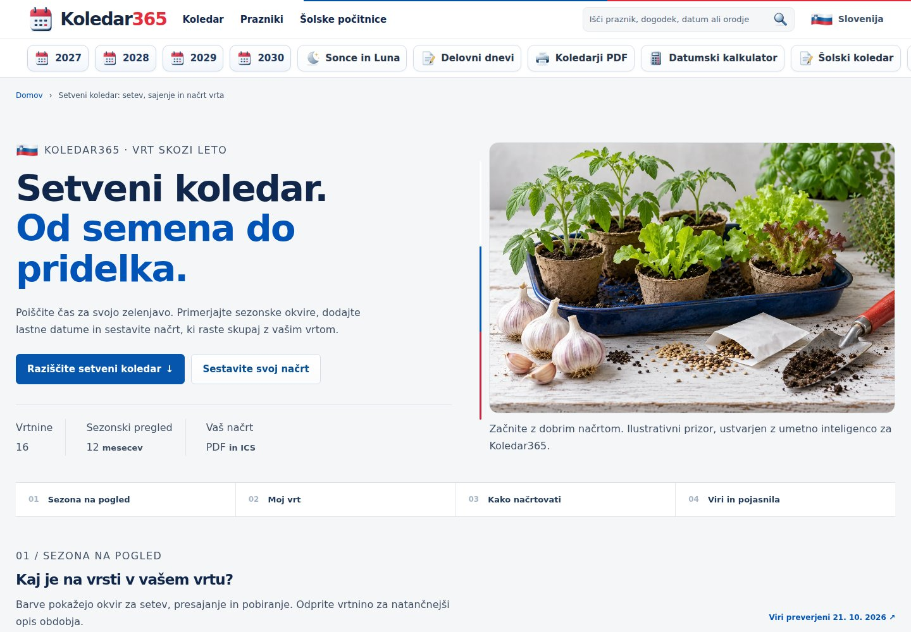
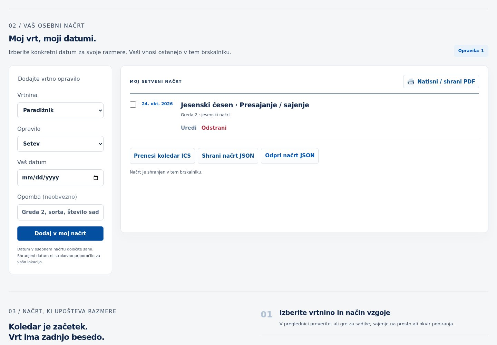
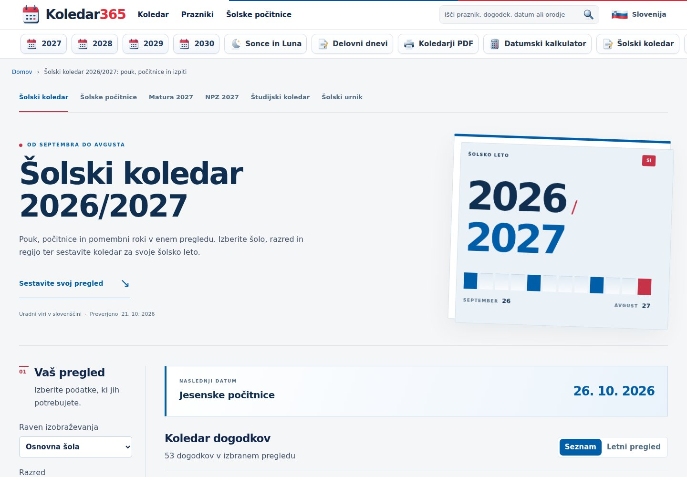
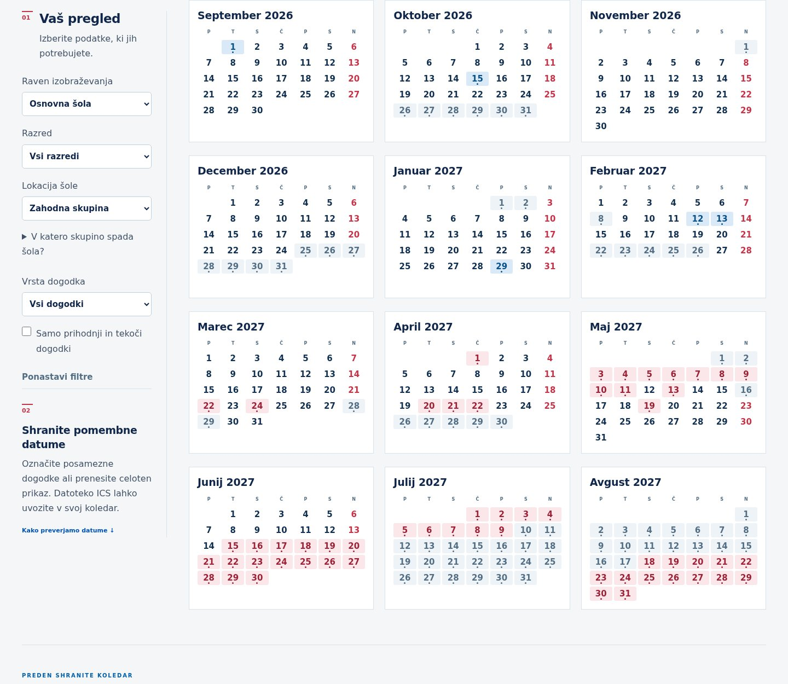
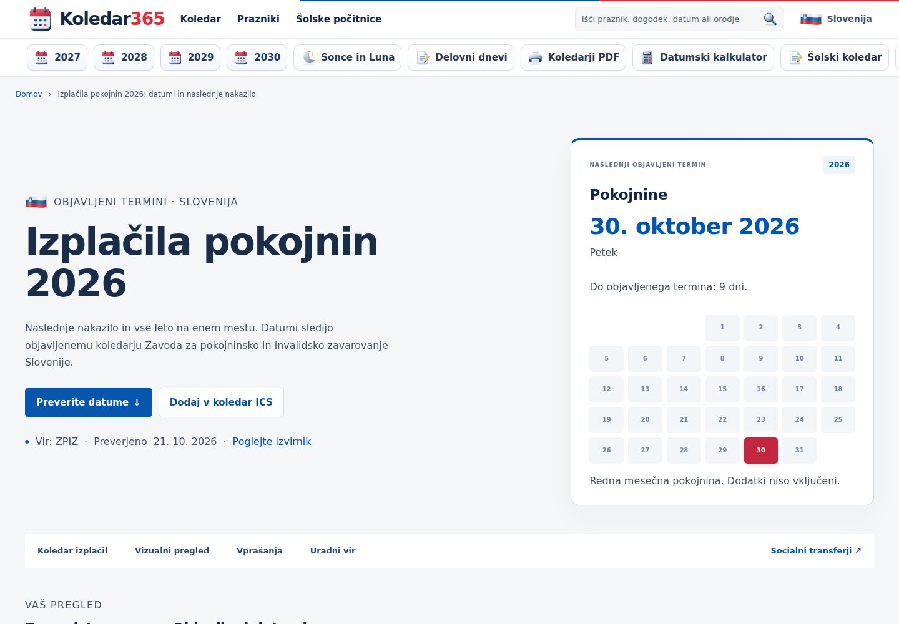
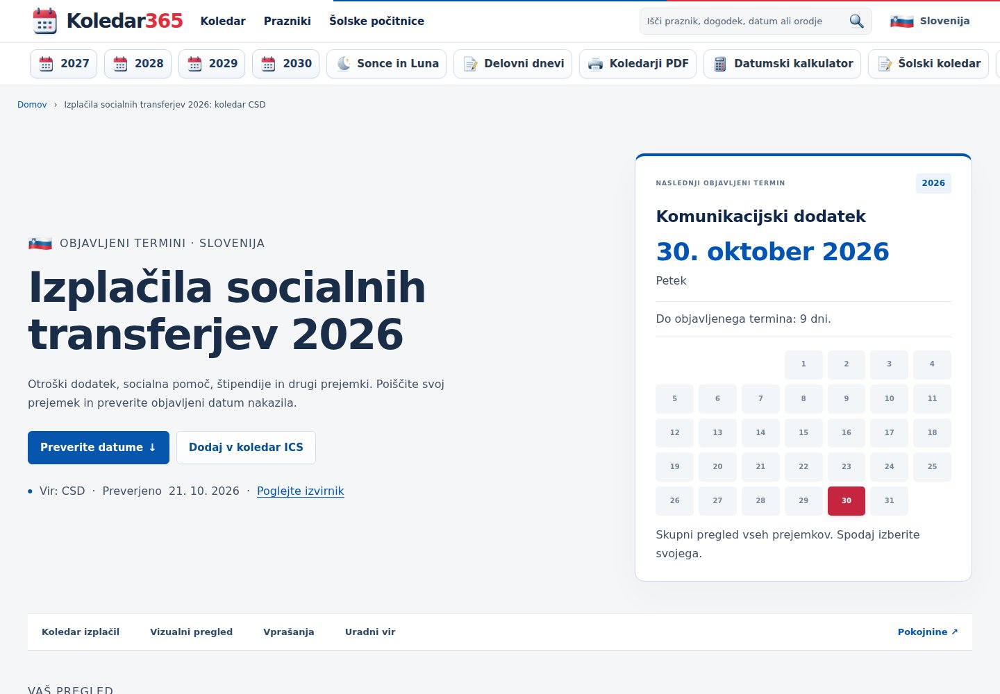
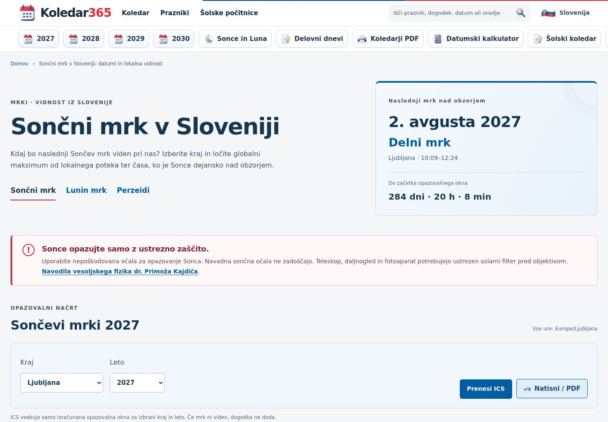
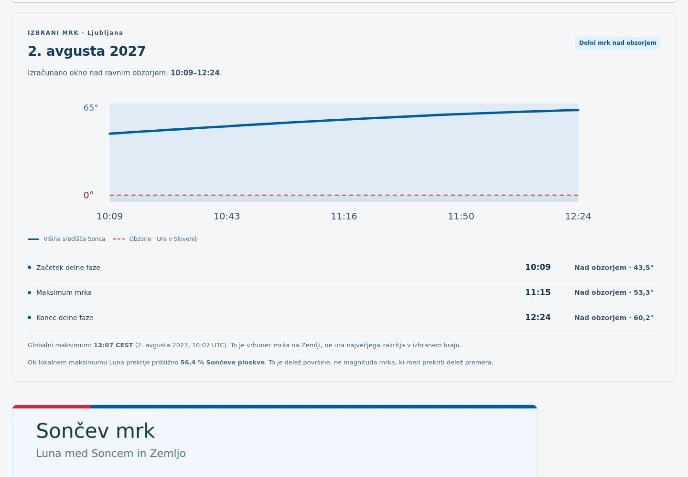
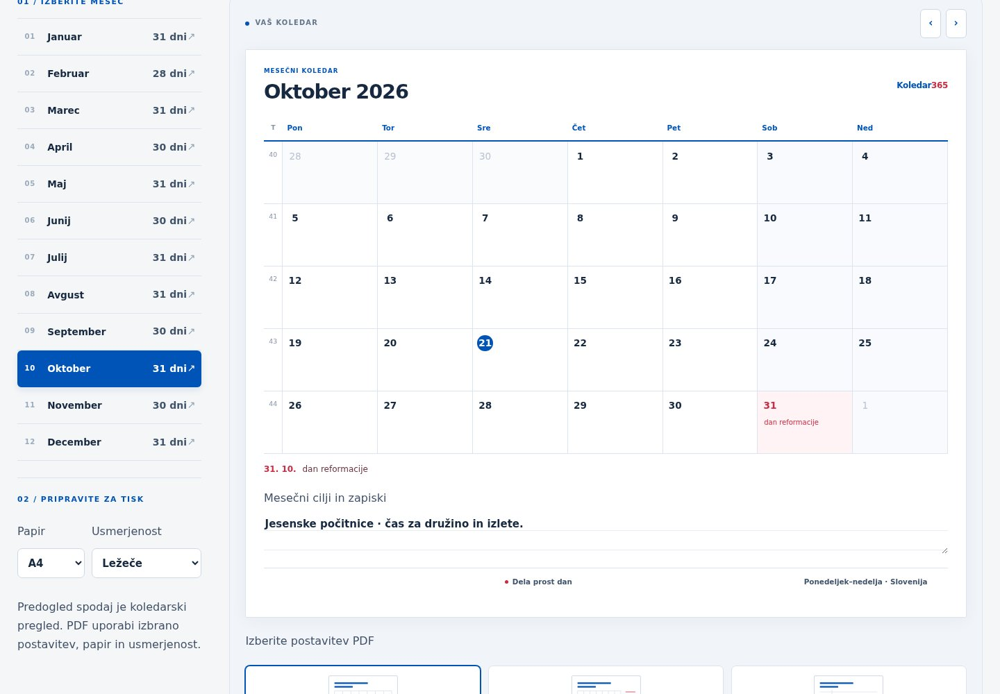

# Calendar expansion — design previews

These are captures of the actual generated partial static preview, with browser locale `sl-SI` and time zone `Europe/Ljubljana`. They demonstrate the prepared interface, not a claim that the production domain has been deployed. The capture date is fixed to 21 October 2026 for reproducibility. All twelve captures were visually reviewed; the accompanying `verification.json` records zero page errors, zero broken visible images and zero horizontal overflow.

## Gardening

[Mobile garden preview](setveni-koledar-mobile.jpg)

## Education

## Official payments

[Mobile pension preview](izplacila-pokojnin-mobile.jpg)

## Astronomy

## Calendar tools and sources

